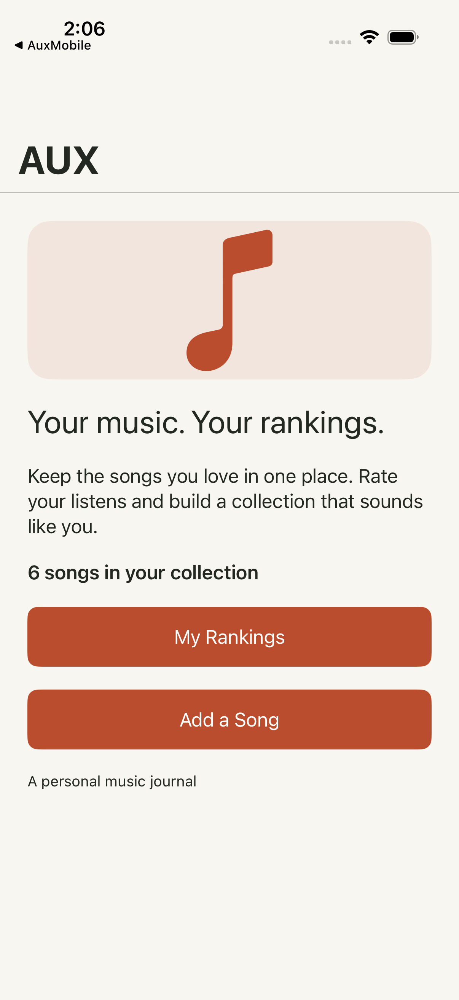
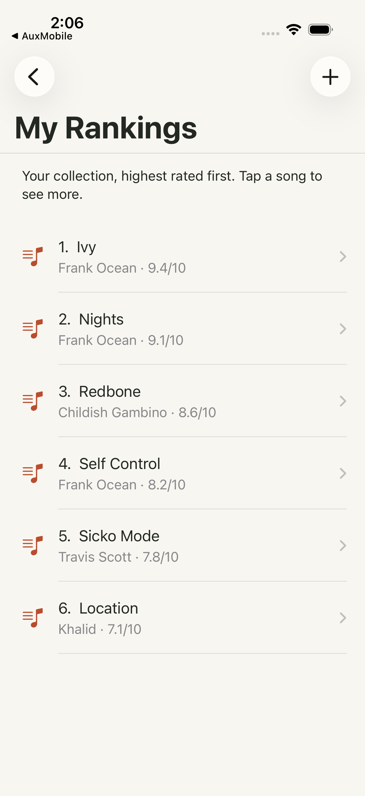
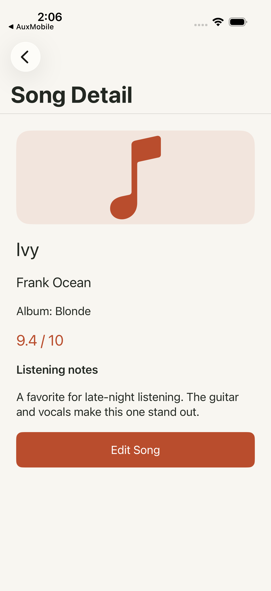
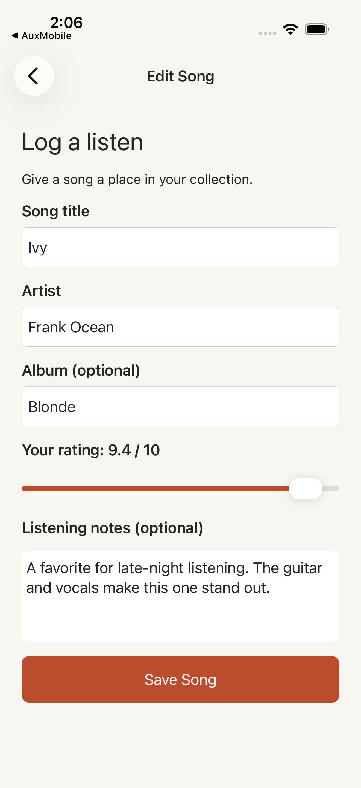
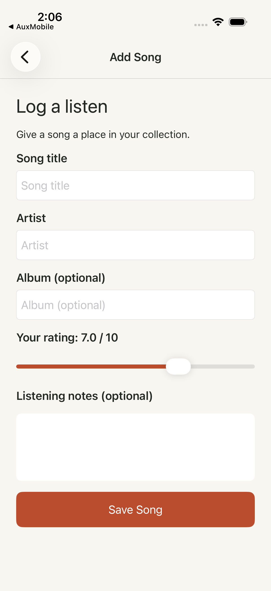

# AUX — Personal Music Rankings

## Project description

AUX is a personal music journal for listeners who want to remember and organize the songs they enjoy. Users can browse their ranked song collection, view a song's artist, album, rating, and listening notes, and add or edit an entry. It solves the problem of losing track of favorite music and personal impressions by keeping them together in a clear, easy-to-browse collection. This milestone presents the core workflow through a native UIKit interface using representative sample songs and in-memory updates.

## Screen list

1. **HomeViewController — Home:** Introduces AUX, shows the collection count, and provides buttons to open My Rankings or add a song.
2. **SongListViewController — My Rankings:** Uses a UITableView to show songs ordered by rating. Selecting a row opens its detail screen; the plus button opens the Add Song form.
3. **SongDetailViewController — Song Detail:** Shows the selected song's title, artist, album, rating, and listening notes. The Edit Song button opens a populated form.
4. **SongFormViewController — Add/Edit Song:** Uses labeled text fields, a rating slider, and a notes text view to enter or update song information. Save updates the in-memory collection and returns to the previous screen. Add and Edit are two modes of the same screen.

## Screen navigation diagram

```text
                      +------------------+
                      |       Home       |
                      +------------------+
                         |            |
             My Rankings |            | Add a Song
                         v            v
                +--------------+   +----------------+
                | My Rankings  |-->|    Add Song    |
                +--------------+   +----------------+
                         |
                  Select a song
                         v
                +--------------+
                | Song Detail  |
                +--------------+
                         |
                     Edit Song
                         v
                +--------------+
                |  Edit Song   |
                +--------------+
```

The `+` button on My Rankings opens Add Song. Add and Edit share SongFormViewController. UINavigationController provides back navigation throughout the app. Saving the form returns to the screen that opened it; returning from a form refreshes the displayed data.

## Milestone implementation

- **UIKit:** All screens use UIViewController and native UIKit controls, written in Swift. No React Native or SwiftUI is used in this project.
- **Auto Layout:** Safe-area anchors position the screens. Scrollable form and detail stacks use content and frame layout guides. The form respects the keyboard layout guide.
- **UIStackView:** Home, detail, and form content use vertical stacks. Each text field is grouped with its label in a nested stack.
- **UITableView:** My Rankings implements UITableViewDataSource and UITableViewDelegate, reusable cells, automatic row heights, and selection navigation.
- **Interaction:** Navigation buttons, table selection, rating slider, and Save work. Blank song titles or artists display an alert.
- **Sample data:** Six songs from the AUX project's demo collection are included. Data resets on relaunch; there is no database, server, account, or external dependency.
- **Design:** Cream backgrounds, rust-colored actions, consistent spacing, and Dynamic Type text styles carry over AUX's visual identity.

## Screenshots

Captured from a running iOS Simulator. The form is shown in both modes.










